# 🍎 한 걸음 (one-step)

> 복잡한 생각을 **한 걸음씩** 정리해볼까요?

막막한 하려는 일를 AI와 함께 **오늘 바로 할 수 있는 작은 행동 하나**로 쪼개 주는 웹 서비스입니다.

하려는 일를 입력하면 AI(Google Gemini)가 **목표 → 작은 과제 → 오늘 할 행동** 순서로 후보를 제안합니다.
사용자는 하나씩 골라 실행하고, 완료한 한 걸음은 DB에 저장되어 "과일 바구니"에 사과로 쌓입니다.

<p align="center">
  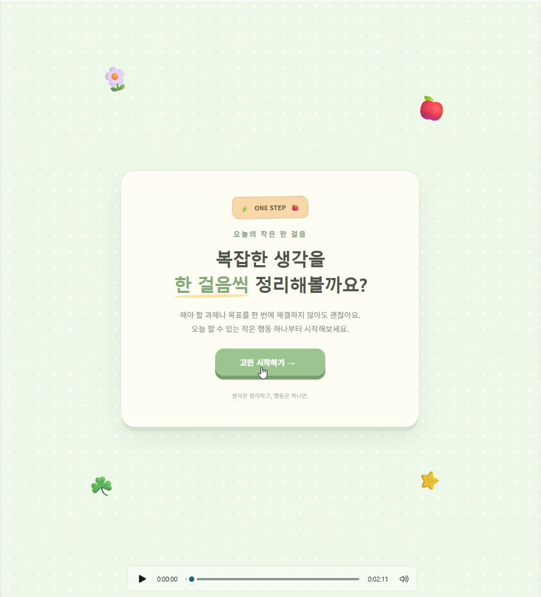
</p>

🎬 **시연 영상**: [한걸음 시연.mp4](one-step/result/한걸음%20시연.mp4)

---

## 목차

1. [화면 흐름](#화면-흐름)
2. [기술 스택](#기술-스택)
3. [시스템 구조](#시스템-구조)
4. [DB 구조](#db-구조)
5. [API](#api)
6. [실행 방법](#실행-방법)
7. [완료 기록이 저장되는 방식](#완료-기록이-저장되는-방식)
8. [변경 이력](#변경-이력)
9. [앞으로 할 것](#앞으로-할-것)

---

## 화면 흐름

### 1. 고민 털어놓기

| 하려는 일 입력 | 우선순위 선택 |
| :---: | :---: |
| 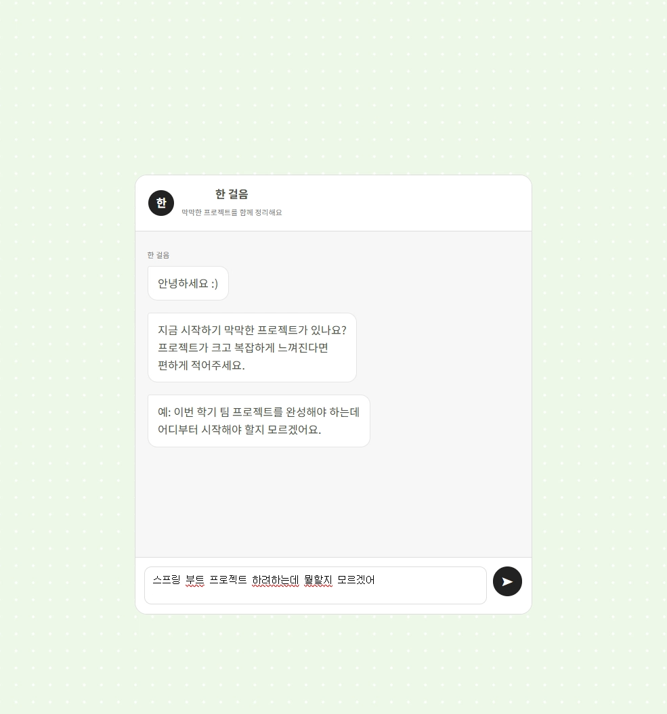 | 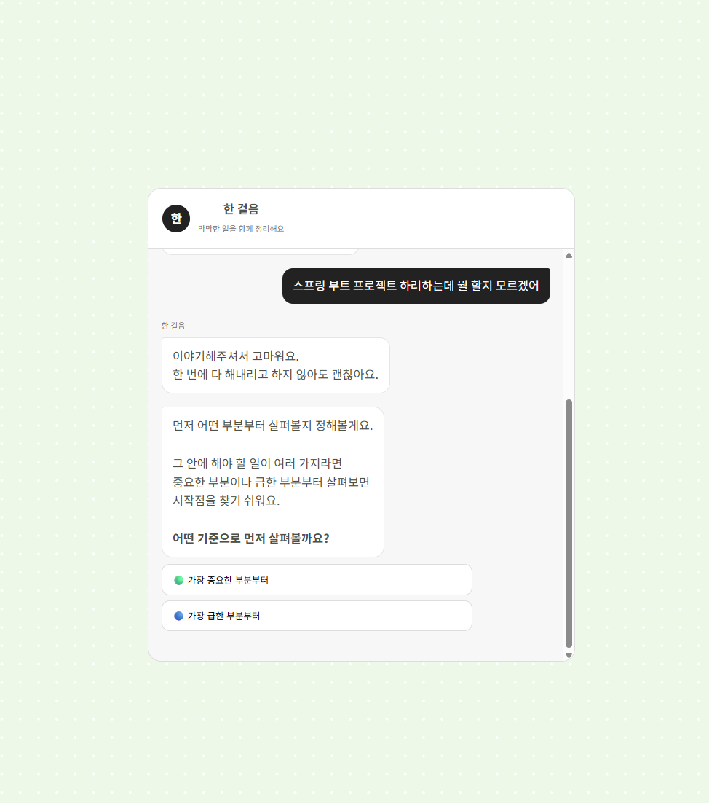 |
| 채팅 형식으로 막막한 하려는 일를 편하게 적습니다. (최대 1000자) | "가장 중요한 부분부터" / "가장 급한 부분부터" 중 기준을 고릅니다. |

### 2. AI와 함께 쪼개기

| ③ 목표 선택 | ④ 작은 과제 선택 | ⑤ 오늘 할 행동 선택 |
| :---: | :---: | :---: |
| 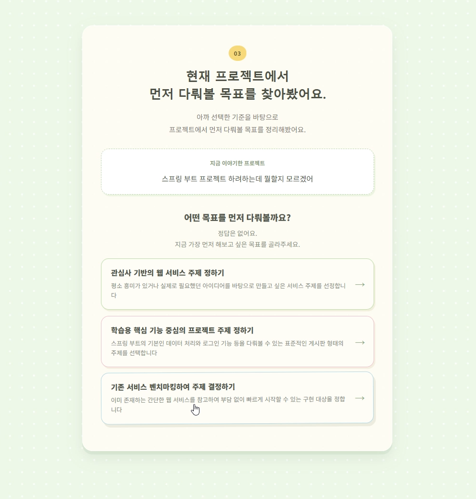 | 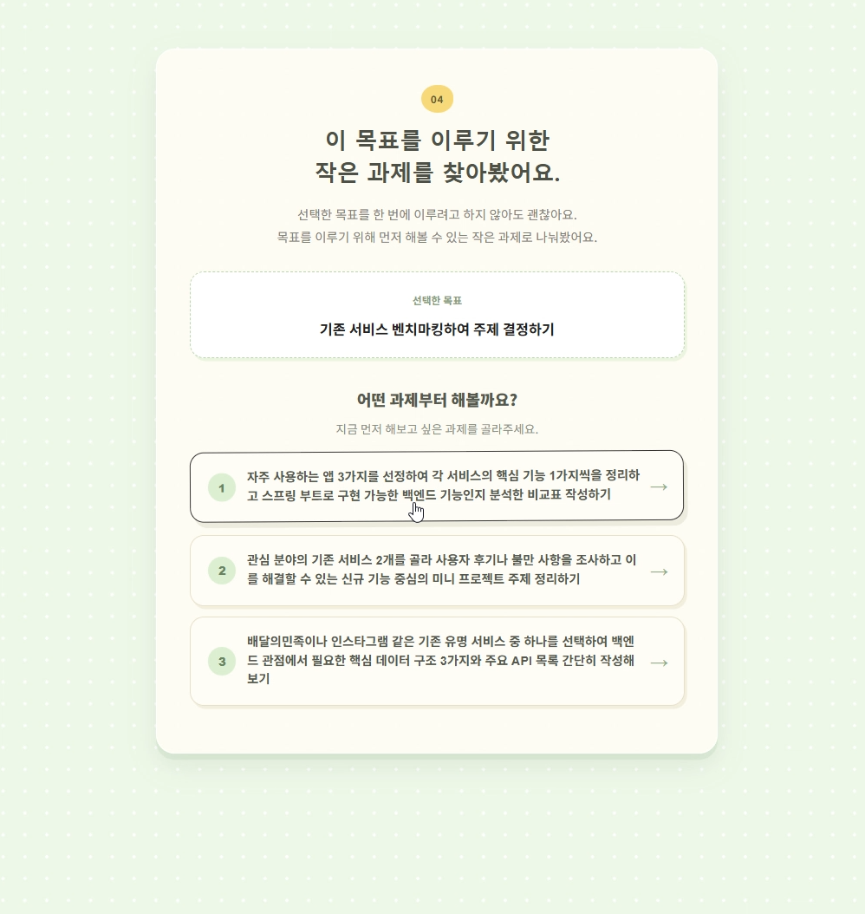 | 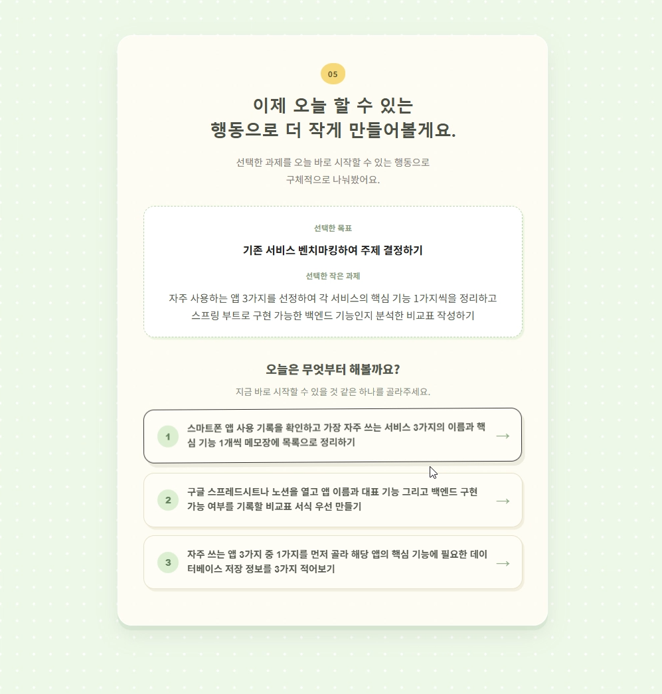 |
| 하려는 일에서 먼저 다뤄볼 목표 후보 3개 | 목표를 이루기 위한 작은 과제 후보 3개 | 오늘 바로 시작할 수 있는 행동 후보 3개 |

### 3. 오늘의 한 걸음 실행

| 시작 확인 | 오늘의 한 걸음 | 실행 |
| :---: | :---: | :---: |
| 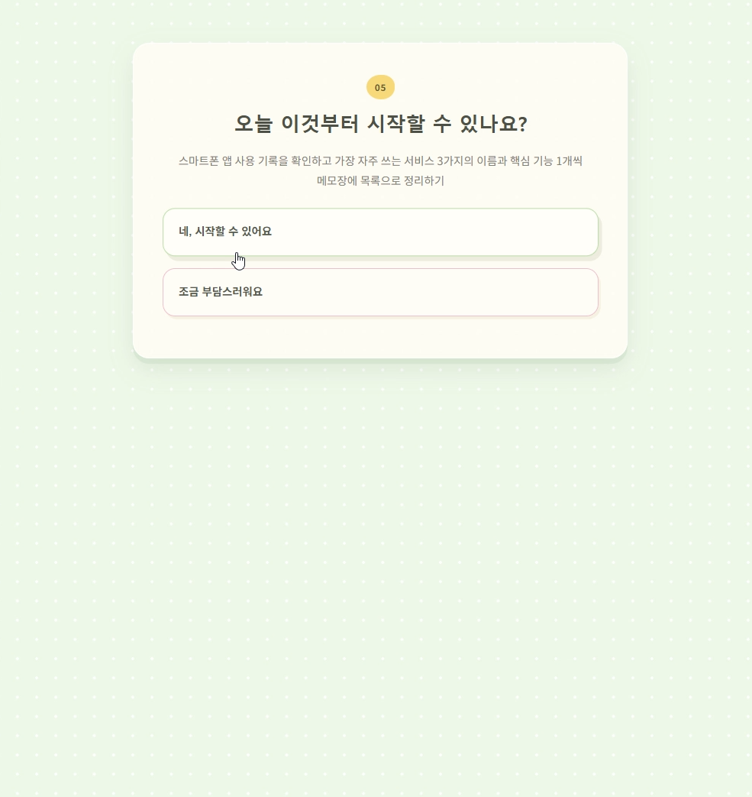 | 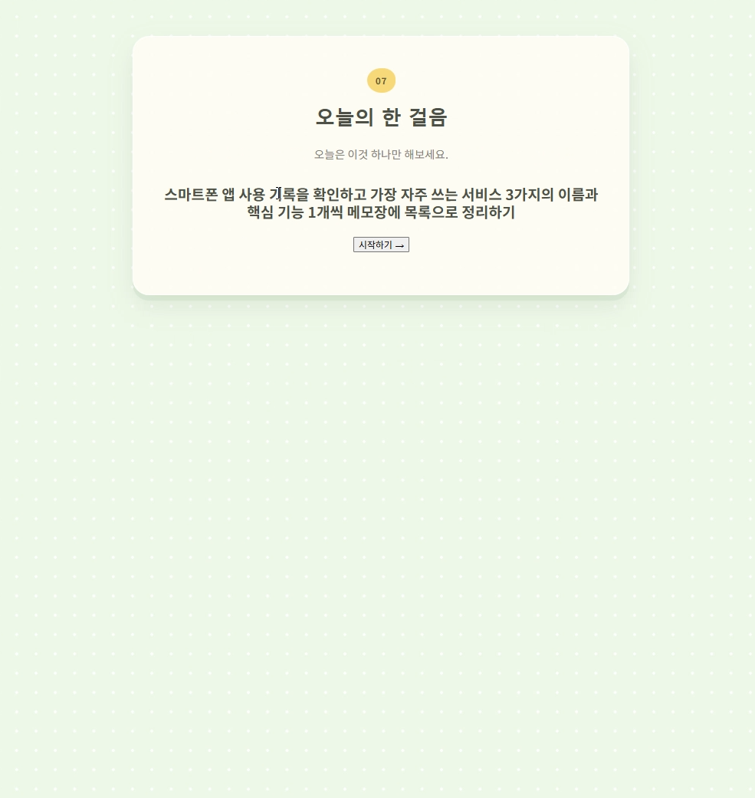 | 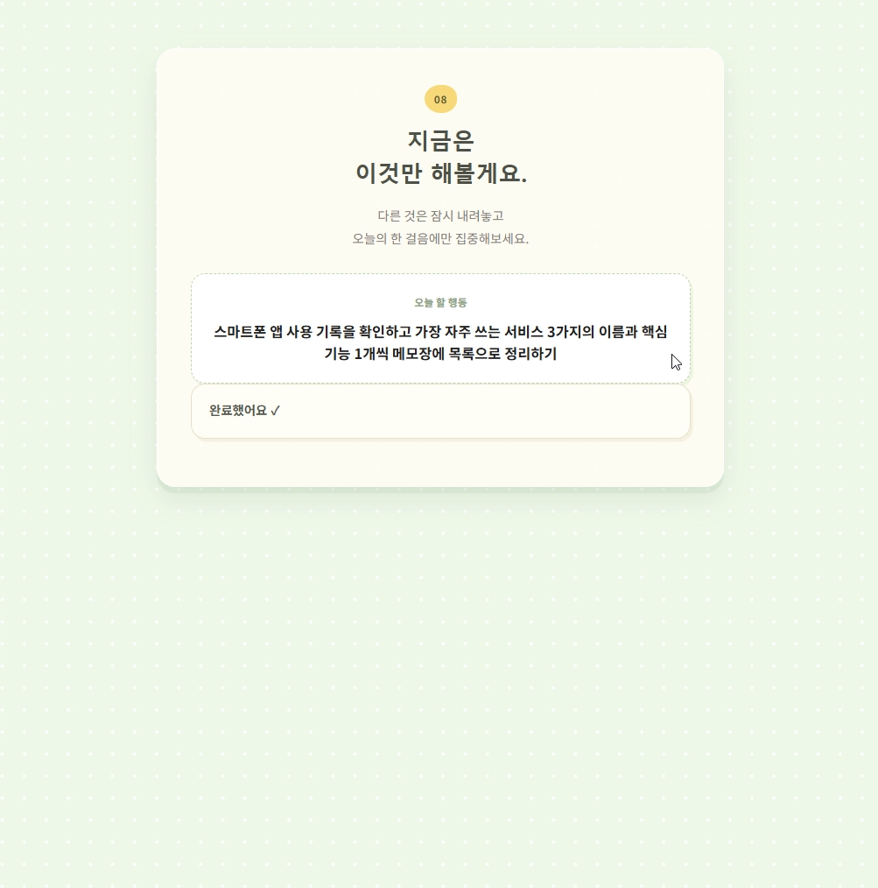 |
| 부담스러우면 "조금 부담스러워요"로 **더 작게 쪼갭니다** | 오늘은 이것 하나만 | 다른 건 내려놓고 이것만 하고 "완료했어요" |

### 4. 완료와 기록

| 한 걸음 완료 | 과일 바구니 |
| :---: | :---: |
| 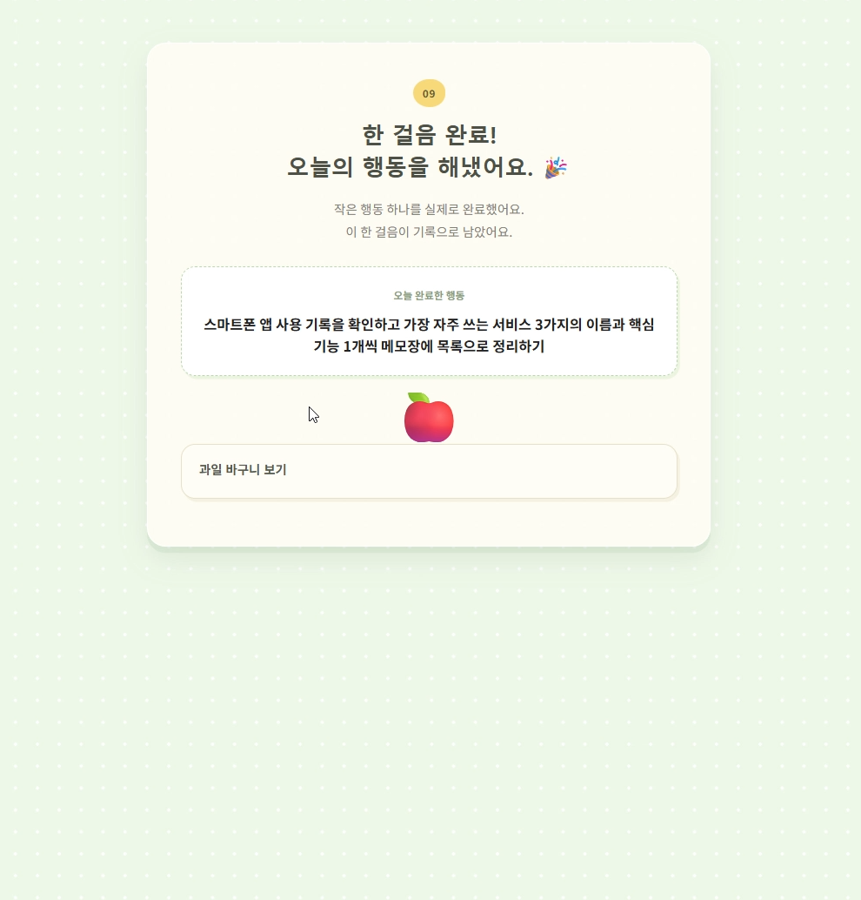 | 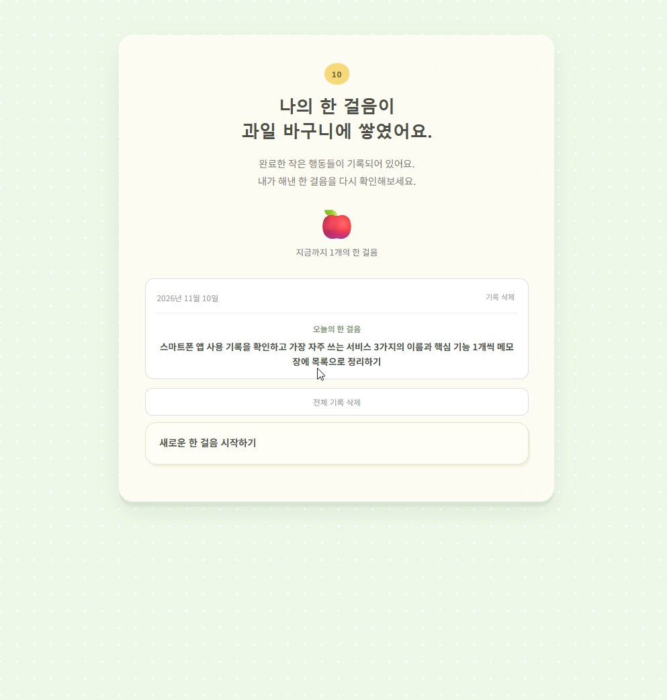 |
| 완료한 행동이 DB에 저장됩니다 | 지금까지 완료한 한 걸음이 사과로 쌓입니다. 기록 1개 삭제와 전체 삭제를 할 수 있습니다 |

---
## 핵심 구현

AI 부분은 `AiService`의 `generateProblems` → `generateActions` → `generateTodayActions` → `generateShrinkActions`로 이어지는 4단계 **프롬프트 체이닝**입니다. 단계마다 앞에서 사용자가 고른 고민·목표·과제를 프롬프트에 다시 넣어 맥락을 유지하고, 응답은 JSON 형식으로 강제해 화면에서 `JSON.parse()`로 바로 읽습니다. 화면 사이의 값은 React Router의 `navigate(path, { state })`로 넘깁니다. 프론트엔드의 `fetchAiWithCache`는 요청 내용을 해시한 키로 `sessionStorage`에 응답을 캐시하고, 같은 요청이 진행 중이면 `Map`에 담아 둔 Promise를 공유해 Gemini 중복 호출을 막습니다. 완료 기록은 `getDeviceId()`가 만든 기기 UUID를 `X-Device-Id` 헤더로 보내 로그인 없이 사용자를 구분합니다. `saveHistory`가 서버 저장에 실패하면 대기 목록에 보관했다가 `syncLocalRecords`가 `/api/history/import`로 다시 보냅니다. 백엔드의 `StepHistoryService.save`는 같은 `clientRecordId`가 이미 있으면 새로 저장하지 않고 기존 기록을 돌려주며, DB의 UNIQUE 제약과 함께 여러 번 보내도 한 번만 저장되도록 합니다.

## 기술 스택

| 구분 | 사용 기술 |
| --- | --- |
| Frontend | React 19, React Router 7, Vite 8 |
| Backend | Java 17, Spring Boot 4.1, Spring Data JPA |
| DB | MySQL 8, Flyway (테이블 변경 이력 관리) |
| AI | Google Gen AI SDK (`google-genai`), Gemini |

## 시스템 구조

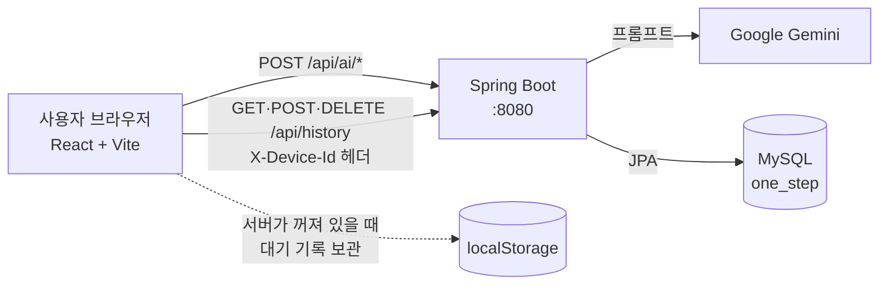

```
onestep-web/
├── backend/                              # Spring Boot API 서버 (포트 8080)
│   ├── src/main/java/com/onestep/backend/
│   │   ├── ai/                           # AI 후보 생성 API (AiController, AiService, DTO)
│   │   ├── history/                      # 완료 기록 API (엔티티, Repository, Service, Controller, DTO)
│   │   └── config/WebConfig.java         # CORS 설정
│   └── src/main/resources/
│       ├── application.properties        # 비밀번호·API 키는 환경 변수로 주입
│       └── db/migration/
│           └── V1__create_step_history.sql
│
└── one-step/                             # React(Vite) 프론트엔드
    ├── src/
    │   ├── pages/                        # 화면별 페이지 (Home → … → FruitBasketPage)
    │   ├── components/
    │   └── utils/
    │       ├── aiCache.js                # AI 응답 캐시
    │       └── oneStepHistory.js         # 완료 기록 저장/조회 (서버 + 오프라인 대기)
    └── result/                           # 화면 캡처, 시연 영상
```

---

## DB 구조

테이블은 Flyway가 만듭니다(`db/migration/V*.sql`). JPA는 `ddl-auto=validate` 설정이라 엔티티와 테이블 구조가 맞는지만 검사합니다.

### step_history: 완료한 한 걸음 기록

| 컬럼 | 타입 | NULL | 설명 |
| --- | --- | --- | --- |
| `id` | BIGINT, PK, AUTO_INCREMENT | NO | 기록 번호 |
| `device_id` | CHAR(36) | NO | 브라우저마다 만든 UUID. 로그인 대신 기기를 구분합니다 |
| `client_record_id` | BIGINT | YES | 브라우저에서 만든 기록 번호. 같은 기록이 두 번 저장되지 않게 막습니다 |
| `project` | VARCHAR(1000) | YES | 입력한 하려는 일 |
| `priority` | VARCHAR(20) | YES | `IMPORTANT` / `URGENT` |
| `goal` | VARCHAR(500) | YES | 선택한 목표 |
| `task` | VARCHAR(500) | YES | 선택한 작은 과제 |
| `action` | VARCHAR(500) | NO | 완료한 행동 |
| `completed_at` | DATETIME(3) | NO | 완료한 시각 (UTC) |
| `created_at` | DATETIME(3) | NO | 서버에 저장된 시각 (UTC) |

- UNIQUE: (`device_id`, `client_record_id`)
- INDEX: (`device_id`, `completed_at`). 내 기록을 최신순으로 조회할 때 씁니다.
- 시간은 모두 UTC로 저장하고, 한국 시간 변환은 화면에서 합니다.

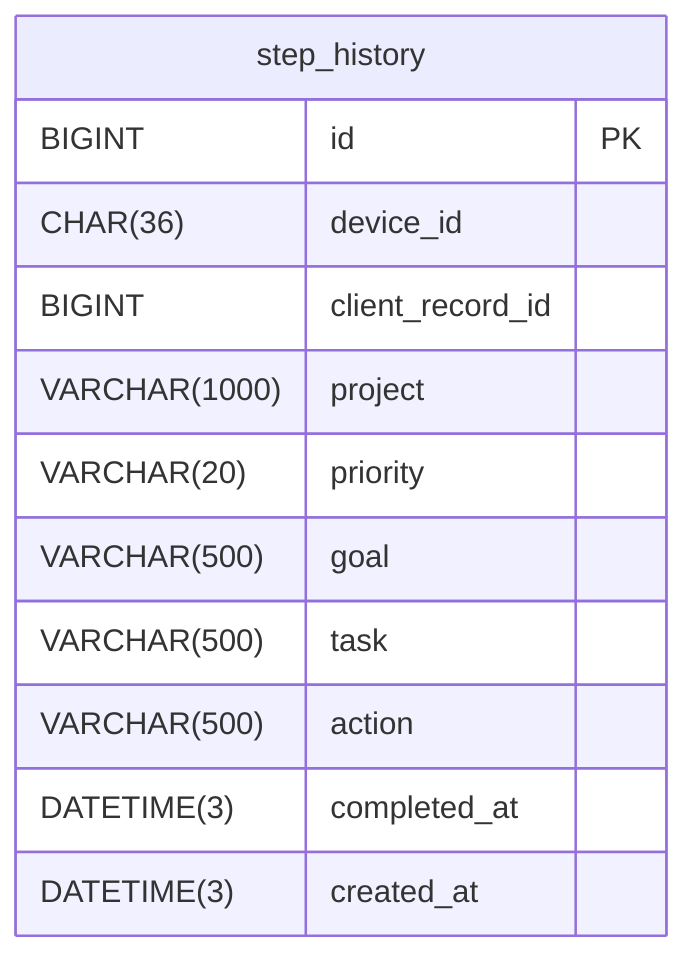

---

## API

### AI 후보 생성: `/api/ai`

| Method | Endpoint | 설명 | 요청 Body |
| --- | --- | --- | --- |
| POST | `/problems` | 하려는 일 → 목표 후보 | `concern`, `priority` (`IMPORTANT` / `URGENT`) |
| POST | `/actions` | 목표 → 작은 과제 후보 | `concern`, `problem` |
| POST | `/today-actions` | 작은 과제 → 오늘 할 행동 후보 | `concern`, `goal`, `task` |
| POST | `/shrink-actions` | 행동을 더 작게 쪼개기 | `concern`, `goal`, `task`, `action` |

### 완료 기록: `/api/history`

모든 요청에 `X-Device-Id: <UUID>` 헤더가 필요합니다. 헤더가 없거나 UUID 형식이 아니면 400을 돌려줍니다.

| Method | Endpoint | 설명 | 응답 |
| --- | --- | --- | --- |
| GET | `/api/history` | 내 기록 목록 (최근 완료 순) | 200 |
| POST | `/api/history` | 기록 1개 저장 | 201 (이미 있던 기록이면 200) |
| POST | `/api/history/import` | 브라우저에 쌓인 기록 한꺼번에 저장 | 200 `{ imported, skipped }` |
| DELETE | `/api/history/{id}` | 기록 1개 삭제 (다른 기기 기록이면 404) | 204 |
| DELETE | `/api/history` | 내 기록 전체 삭제 | 204 |

<details>
<summary>저장 요청 / 응답 예시</summary>

```http
POST /api/history
X-Device-Id: 3f2b8c1e-7a4d-4e21-9c55-1b2d3e4f5a6b
Content-Type: application/json

{
  "clientRecordId": 1762675200000,
  "project": "스프링 부트 하려는 일 하려하는데 뭘할지 모르겠어",
  "priority": "URGENT",
  "goal": "기존 서비스 벤치마킹하여 주제 결정하기",
  "task": "자주 사용하는 앱 3가지를 선정하여 핵심 기능 비교표 작성하기",
  "action": "스마트폰 앱 사용 기록을 확인하고 가장 자주 쓰는 서비스 3가지 정리하기",
  "completedAt": "2026-11-10T00:08:28.918Z"
}
```

```json
{
  "id": 7,
  "clientRecordId": 1762675200000,
  "project": "스프링 부트 하려는 일 하려하는데 뭘할지 모르겠어",
  "priority": "URGENT",
  "goal": "기존 서비스 벤치마킹하여 주제 결정하기",
  "task": "자주 사용하는 앱 3가지를 선정하여 핵심 기능 비교표 작성하기",
  "action": "스마트폰 앱 사용 기록을 확인하고 가장 자주 쓰는 서비스 3가지 정리하기",
  "completedAt": "2026-11-10T00:08:28.918Z"
}
```

</details>

---

## 실행 방법

### 1. 준비물

- JDK 17 이상
- Node.js 20 이상
- MySQL 8
- Google Gemini API 키

빈 데이터베이스만 만들어 두면, 테이블은 서버가 처음 켜질 때 Flyway가 만듭니다.

```sql
CREATE DATABASE one_step DEFAULT CHARACTER SET utf8mb4;
```

### 2. 환경 변수 설정

비밀번호와 API 키는 코드에 넣지 않고 환경 변수로 넣습니다. `application.properties`에서는 `${DB_PASSWORD}`처럼 이름만 참조합니다.

| 환경 변수 | 설명 | 필수 |
| --- | --- | --- |
| `DB_PASSWORD` | MySQL 비밀번호 | O |
| `DB_USERNAME` | MySQL 계정 (기본값 `root`) | X |
| `GOOGLE_API_KEY` | Google Gemini API 키 | O |

```powershell
# Windows (영구 저장. 설정한 뒤 터미널과 IDE를 완전히 껐다 켜야 적용됩니다)
setx DB_PASSWORD "내_DB_비밀번호"
setx GOOGLE_API_KEY "발급받은_API_키"
```

```bash
# macOS / Linux (현재 터미널에서만 유효)
export DB_PASSWORD=내_DB_비밀번호
export GOOGLE_API_KEY=발급받은_API_키
```

### 3. Backend 실행

```bash
cd backend
./mvnw spring-boot:run       # Windows: .\mvnw.cmd spring-boot:run
```

`http://localhost:8080`에서 실행됩니다. 백엔드는 API만 제공해서, 브라우저로 이 주소를 열면 404(Whitelabel Error Page)가 나오는 것이 정상입니다.

### 4. Frontend 실행

```bash
cd one-step
npm install
npm run dev
```

Vite가 알려주는 주소(기본 `http://localhost:5173`)로 접속합니다. 다른 하려는 일가 5173을 쓰고 있으면 5174, 5175처럼 다음 포트로 뜨니, 터미널에 찍힌 주소를 확인하세요. 백엔드 CORS는 `localhost`의 모든 포트를 허용합니다.

---

## 완료 기록이 저장되는 방식

- **기기 구분**: 처음 접속할 때 `crypto.randomUUID()`로 UUID를 만들어 `localStorage["one-step:device-id"]`에 저장하고, 모든 기록 요청에 `X-Device-Id`로 보냅니다.
- **서버가 꺼져 있을 때**: 저장에 실패한 기록은 `localStorage["one-step:pending"]`에 대기시킵니다. 다음에 과일 바구니를 열 때 자동으로 다시 보냅니다. 그동안 과일 바구니에는 "서버에 연결하지 못했어요" 안내와 함께 이 기기에 남은 기록이 보입니다.
- **중복 방지**: 브라우저에서 만든 기록 번호를 `clientRecordId`로 함께 보냅니다. 같은 기록을 여러 번 보내도 DB에는 한 번만 저장됩니다.
- **예전 기록 옮기기**: 예전 버전에서 `localStorage["one-step:history"]`에 쌓인 기록은 처음 한 번 `/api/history/import`로 DB에 옮깁니다. 옮긴 뒤에는 `one-step:migrated`로 표시하고, 원본은 백업으로 지우지 않습니다.

---

## 변경 이력

### 2026-11-10

- **버그 수정: 완료 기록에 행동만 저장되던 문제.** "오늘 이것부터 시작할 수 있나요?" 화면(`ActionStartPage`)과 "오늘의 한 걸음" 화면(`TodayActionPage`)이 다음 화면으로 `action`만 넘기고 있었습니다. 그래서 하려는 일·우선순위·목표·과제가 중간에 빠졌습니다. 이제 앞에서 받은 값을 그대로 넘깁니다.
- `vite.config.js`: `result/` 폴더와 `.mp4` 파일을 개발 서버 파일 감시에서 제외. 녹화 중인 영상 파일 때문에 `EBUSY` 오류로 개발 서버가 꺼지던 문제를 막았습니다.
- CORS가 `localhost`의 모든 포트를 허용하도록 변경했습니다.

### 2026-11-09: 완료 기록 DB 저장

이전에는 완료 기록이 브라우저 localStorage에만 저장되어 MySQL을 쓰지 않았습니다. 그래서 브라우저 데이터를 지우거나 다른 브라우저로 접속하면 기록이 사라졌습니다.

**Backend**
- `step_history` 테이블 추가 (Flyway `V1__create_step_history.sql`)
- 완료 기록 API `/api/history` 추가 (저장, 목록, 1개 삭제, 전체 삭제, 한꺼번에 옮기기)
- `ddl-auto`를 `update`에서 `validate`로 변경. 테이블은 Flyway가 관리합니다.
- 시간대를 UTC로 통일 (`serverTimezone=UTC`, `hibernate.jdbc.time_zone=UTC`)
- CORS 설정을 `AiController`의 `@CrossOrigin`에서 `config/WebConfig`로 옮겨 `/api/**` 전체에 적용
- DB 비밀번호를 환경 변수 `DB_PASSWORD`로 주입
- 버그 수정: `AiController`의 `/shrink-actions` 메서드가 클래스 밖에 있어서 컴파일되지 않던 문제

**Frontend**
- `oneStepHistory.js`: localStorage 저장을 서버 API 호출로 변경. 기기 ID, 오프라인 대기와 재전송, 예전 기록 옮기기를 추가했습니다.
- `FruitBasketPage.jsx`: 서버에서 기록을 불러옵니다. "불러오는 중"과 "서버 연결 안 됨" 안내를 추가했습니다.
- 하려는 일 입력칸 최대 1000자 제한 (DB 컬럼 길이와 맞춤)

---

## 앞으로 할 것

- **로그인**: `users` 테이블을 만들고 `step_history`에 `user_id` 컬럼을 추가하는 Flyway `V2` 파일을 만들면 됩니다. 로그인할 때 `UPDATE step_history SET user_id = ? WHERE device_id = ? AND user_id IS NULL`로 이 기기의 기록을 사용자에게 연결합니다.
- **흐름 전체 저장**: 하려는 일 → 목표 → 과제 → 행동을 각각 테이블로 나눠 저장하면, 고르지 않은 후보나 "더 작게 쪼개기" 이력도 남길 수 있습니다.
- **주의**: 지금은 로그인이 없어서, `device_id`를 아는 사람은 그 기록을 볼 수 있습니다. 공개 배포 전에는 접근 제한이 필요합니다.
